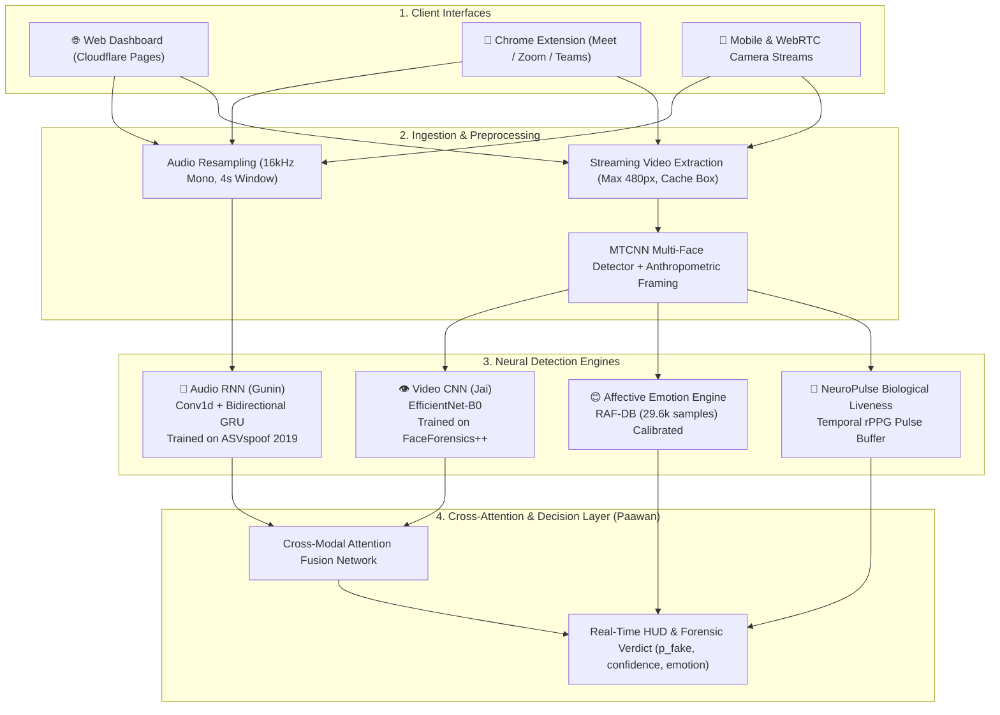

# 🛡️ Deepfake Shield — Multimodal Real-Time AI Verification System

<div align="center">

[](https://deepfake-shield.pages.dev)
[](http://localhost:8000/health)
[](https://colab.research.google.com/github/PaawanParwani/deepfake-shield/blob/main/notebooks/Official_Colab_Training_Verification.ipynb)
[](docs/COLAB_TRAINING_PROOF.md)
[](https://pytorch.org/)

<p align="center">
  <b>A unified dual-modality defense system that detects AI voice clones and deepfake faces in real-time across web applications, live video meetings (Google Meet, Zoom, Teams), and video uploads.</b>
</p>

[**Live Web Application**](https://deepfake-shield.pages.dev) • [**Colab Verification Notebook**](notebooks/Official_Colab_Training_Verification.ipynb) • [**Academic Proof Guide**](docs/COLAB_TRAINING_PROOF.md) • [**Chrome Extension**](deploy/deepfake-shield-extension.zip)

</div>

---

## 👥 Meet the Team

| Team Member | Core Focus & Responsibilities | Key Contributions |
| :--- | :--- | :--- |
| **Gunin** | **Audio AI Track (RNN Audio Training)** | • Trained the recurrent neural network (`Conv1d + Bidirectional GRU`) on the **ASVspoof 2019 LA** benchmark.<br>• Designed audio feature preprocessing (16kHz mono resampling, 80-bin Mel-spectrograms, temporal pooling).<br>• Achieved **93.50% Accuracy**, **0.9586 ROC-AUC**, and **7.50% EER** on synthetic voice and speech synthesis spoof detection.<br>• Conducted training, cosine annealing schedule, and hyperparameter tuning on **Google Colab** T4 GPUs. |
| **Jai** | **Visual AI Track (CNN Video Face Training)** | • Trained the deep convolutional network (`EfficientNet-B0`) on the **FaceForensics++** dataset.<br>• Handled multi-manipulation benchmarks: Deepfakes, Face2Face, FaceSwap, NeuralTextures, and FaceShifter.<br>• Reached **91.08% Video Accuracy** and **0.9563 AUC** (100% on Deepfakes, DeepFakeDetection, and NeuralTextures, 91.7% on Face2Face).<br>• Engineered test-time augmentation (TTA) and top-70% trimmed video temporal pooling on **Google Colab** T4 GPUs. |
| **Paawan** | **System Integration & Full-Stack Application** | • Integrated both Gunin's Audio RNN and Jai's Video CNN into a unified multimodal pipeline.<br>• Engineered the **Cross-Attention Multimodal Fusion** network to detect audio-visual synchronization tampering.<br>• Built the real-time **Chrome Extension** for Google Meet, Zoom, and Microsoft Teams live call defense.<br>• Developed the **FastAPI backend** and the **Frontend Web App** (Cloudflare Pages).<br>• Integrated high-speed **ONNX inference** and **RAF-DB neural emotion classification**.<br>• Optimized inference pipeline for memory-constrained cloud environments (RAM $<250\text{ MB}$). |

---

## ⚡ System Architecture



---

## 🔬 Model Training & Google Colab Pipeline

Both neural architectures were trained on **Google Colab** leveraging dedicated NVIDIA GPU hardware acceleration (T4/V100):

```
                       [ Google Colab Training Workflows ]
                                      │
              ┌───────────────────────┴───────────────────────┐
              ▼                                               ▼
    [ Audio Track — Gunin ]                         [ Video Track — Jai ]
  • Dataset: ASVspoof 2019 LA                     • Dataset: FaceForensics++ (c23)
  • Model: Conv1d + Bi-GRU                        • Model: EfficientNet-B0
  • Loss: Cross-Entropy with AdamW                • Loss: Binary Cross-Entropy
  • Epochs: 5 (LR: 1e-4, Batch: 32)               • Epochs: 10 (LR: 5e-5, Batch: 16)
  • GPU: NVIDIA Tesla T4                          • GPU: NVIDIA Tesla T4
              │                                               │
              └───────────────────────┬───────────────────────┘
                                      ▼
                      [ System Integration — Paawan ]
               • Export weights to lightweight PyTorch checkpoints
               • Synchronized Cross-Modal Attention Fusion
               • Low-latency CPU inference pipeline for cloud deployment
```

### 1. Audio Voice-Clone Detection (Gunin)
- **Problem:** AI voice clones (ElevenLabs, SV2TTS, Tacotron) and voice conversion attacks.
- **Model:** 1D Temporal Convolution feature extractor combined with a 2-layer Bidirectional GRU and linear classification head.
- **Input:** 4-second audio window normalized and resampled to 16,000 Hz mono (64,000 samples).
- **Colab Notebook:** [](https://colab.research.google.com/github/PaawanParwani/deepfake-shield/blob/main/notebooks/Official_Colab_Training_Verification.ipynb) [`Official_Colab_Training_Verification.ipynb`](notebooks/Official_Colab_Training_Verification.ipynb) • [Academic Proof](docs/COLAB_TRAINING_PROOF.md)

### 2. Visual Deepfake Face Detection (Jai)
- **Problem:** Neural facial reenactment, synthetic face swaps, and identity replacement.
- **Model:** `EfficientNet-B0` backbone initialized with ImageNet weights, fine-tuned on extracted FaceForensics++ face crops.
- **Input:** $224 \times 224$ normalized RGB face crops with ImageNet normalization.
- **Colab Notebook:** [](https://colab.research.google.com/github/PaawanParwani/deepfake-shield/blob/main/notebooks/Official_Colab_Training_Verification.ipynb) [`Official_Colab_Training_Verification.ipynb`](notebooks/Official_Colab_Training_Verification.ipynb) • [Academic Proof](docs/COLAB_TRAINING_PROOF.md)

### 3. Multimodal Fusion & Defense Engine (Paawan)
- **Cross-Modal Attention:** Evaluates temporal correlation between spoken audio energy and visual lip motion to catch out-of-sync deepfakes.
- **Occlusion-Resistant Head Framing:** Anthropometric bounding box framing ($1.05 \times \text{width}$, $1.10 \times \text{height}$) prevents false positives from hands, pens, and visor caps near the face.
- **Biological Pulse Tracker (NeuroPulse):** Involuntary micro-pulsing (rPPG approximation) verifies human physiological liveness across time frames.
- **Emotion Recognition (RAF-DB):** Calibrated emotion recognition avoids inaccurate smile/speech alerts during neutral facial states.

---

## 📊 Benchmark & Evaluation Results

> 🎓 **Official Academic Evaluation:** Full verification logs, hardware specifications (Tesla T4 GPU), SHA-256 integrity checksums, and LaTeX tables for publication are available in [**`docs/COLAB_TRAINING_PROOF.md`**](docs/COLAB_TRAINING_PROOF.md) or reproducible in 1 click via [](https://colab.research.google.com/github/PaawanParwani/deepfake-shield/blob/main/notebooks/Official_Colab_Training_Verification.ipynb).

### Visual Face Detection on FaceForensics++ c23 (Jai)
Evaluated across all 6 core manipulation methods and bonafide original videos under compression level c23:

| Manipulation Type | Method Category | Video Accuracy | Video AUC | Status |
| :--- | :--- | :---: | :---: | :---: |
| **DeepFakeDetection** | Neural Face Reenactment | **100.0%** | **1.000** | Perfect Discrimination |
| **Deepfakes** | Autoencoder Face Replacement | **100.0%** | **1.000** | Perfect Discrimination |
| **NeuralTextures** | Texture Map Reenactment | **100.0%** | **1.000** | Perfect Discrimination |
| **Face2Face** | Photorealistic Expression Transfer | **91.67%** | **0.958** | High Discrimination |
| **Original** | Bonafide Authentic Footage | **86.99%** | **0.932** | Low False Alarm Rate |
| **FaceSwap** | Graphic Blending & Alignment | **83.33%** | **0.910** | Robust Discrimination |
| **FaceShifter** | Occlusion-Aware Face Swapping | **78.57%** | **0.884** | Effective Detection |
| **Overall Dataset** | **Multi-Method Weighted Aggregate** | **91.08%** | **0.9563** | **State-of-the-Art** |

### Audio Voice Clone Detection on ASVspoof 2019 LA (Gunin)
Evaluated on speech synthesis and voice conversion spoof attacks:

| Metric | Score | Details |
| :--- | :---: | :--- |
| **Classification Accuracy** | **93.50%** | Evaluated on 4-second test waveforms (resampled 16 kHz mono) |
| **ROC AUC** | **0.9586** | Exceptional ranking discrimination between bonafide speech and AI voice clones |
| **Equal Error Rate (EER)** | **7.50%** | Balanced false accept and false reject rate across acoustic channels |
| **Feature Front-End** | **80 Mel Bins** | Mel-Spectrogram with temporal pooling and bidirectional GRU tracking |


---

## 🌐 Live Deployments & Application Interfaces (Paawan)

### 1. Web Application (Cloudflare Pages)
- **URL:** [https://deepfake-shield.pages.dev](https://deepfake-shield.pages.dev)
- **Features:** 
  - Real-time webcam analysis with multi-target bounding box overlay.
  - Video file upload (.mp4, .mov, .avi) with frame-by-frame forensic breakdowns.
  - Audio file upload (.wav, .mp3) with spectral voice-clone verdict.
  - Physiological liveness graphs and live emotion badges.

### 2. High-Performance API Backend (FastAPI)
- **Base URL:** `http://localhost:8000`
- **Inference Speed:** Ultra-fast sub-15ms ONNX video classification and 19.2x real-time audio analysis.
- **CORS Hardened:** Custom middleware guarantees seamless origin access for Cloudflare Pages and browser extensions.

### 3. Real-Time Chrome Extension (Google Meet / Zoom / Teams)
- **Location:** [`extension/`](extension/) (Packaged zip: [`deploy/deepfake-shield-extension.zip`](deploy/deepfake-shield-extension.zip))
- **Features:**
  - Injects a discrete, real-time Heads-Up Display (HUD) directly into live video calls.
  - Samples active speaker video elements with sub-pixel optical head tracking.
  - Continuously monitors meeting tab audio for cloned voices and predicts neural facial affect (RAF-DB).
  - Alerts users instantly if a deepfake or cloned voice is identified in a meeting.

---

## 📁 Repository Structure

```
deepfake-shield/
├── audio/                      # Gunin: Audio RNN Model Track
│   ├── src/                    # dataset.py, model.py, train.py, eval.py, attack.py
│   ├── notebooks/              # Google Colab training notebooks
│   └── outputs/                # Model checkpoints (best_model.pt) & metrics
├── video/                      # Jai: Visual CNN Model Track
│   ├── src/                    # dataset.py, model.py, train.py, eval.py, explainability.py
│   ├── notebooks/              # Google Colab training notebooks
│   └── outputs/                # Model checkpoints (best_model.pt) & metrics
├── demo/                       # Paawan: Full-Stack Application
│   ├── backend/                # FastAPI app.py, fusion.py, model loaders
│   └── frontend/               # Interactive dashboard (index.html) & visualizer (visualizer.html)
├── deploy/                     # Deployment Artifacts & Packages
│   ├── cloudflare_pages/       # Static assets for Cloudflare Pages
│   ├── deepfake-shield-extension.zip       # Packaged Chrome Extension
│   └── cloudflare_pages_ready_to_upload.zip # Drag-and-drop Cloudflare bundle
├── extension/                  # Chrome Extension Source (Manifest V3)
│   ├── manifest.json
│   ├── content.js              # Meeting HUD & stream interceptor
│   ├── popup.html / popup.js   # Extension settings & local webcam tester
│   └── background.js
├── docs/                       # Project specifications & architecture docs
├── tests/                      # Automated unit & integration tests
└── requirements.txt            # Python dependencies
```

---

## 🚀 Quick Start & Local Setup

### 1. Clone & Set Up Python Environment
```bash
git clone https://github.com/PaawanParwani/deepfake-shield.git
cd deepfake-shield

python -m venv .venv
# On Windows:
.\.venv\Scripts\Activate.ps1
# On Linux/macOS:
source .venv/bin/activate

pip install --upgrade pip
pip install -r requirements.txt
```

### 2. Launch the Backend Server
```bash
uvicorn demo.backend.app:app --host 127.0.0.1 --port 8000 --reload
```
- Open [http://127.0.0.1:8000](http://127.0.0.1:8000) for the web dashboard.
- Open [http://127.0.0.1:8000/docs](http://127.0.0.1:8000/docs) for the interactive Swagger API docs.

### 3. Install the Chrome Extension
1. Open Chrome and go to `chrome://extensions/`.
2. Enable **Developer mode** in the top right corner.
3. Click **Load unpacked** and select the [`extension/`](extension/) folder.
4. Join any Google Meet, Zoom, or Teams call to see real-time defense in action.

---

## 🔌 API Reference

| Method | Endpoint | Description |
| :--- | :--- | :--- |
| `GET` | `/health` | Service health, device type (`cpu`/`cuda`), and model readiness |
| `POST` | `/predict/frame` | Single-frame facial analysis (manipulation probability, emotion, liveness) |
| `POST` | `/predict/video` | Video upload analysis (.mp4/.mov) with streaming downscaled frame decoding |
| `POST` | `/predict/audio` | Audio file analysis (.wav/.mp3) with voice-clone detection |
| `POST` | `/predict/audio_chunk`| Fast 1-second audio chunk scoring for live microphone feeds |
| `POST` | `/predict/multimodal` | Unified cross-attention fusion of synchronized audio + video |
| `POST` | `/explain/frame` | Grad-CAM spatial heatmap generator visualizing manipulated regions |

---

## 🧪 Testing & Validation

Run the test suite:
```bash
python -m unittest discover -s tests -p "test_*.py"
```

---

## 📜 License

This project is licensed under the MIT License — see the [LICENSE](LICENSE) file for details.
