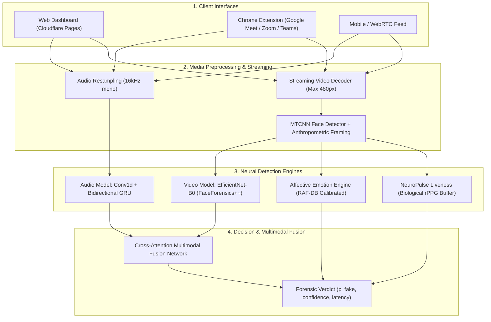

# 🛡️ Deepfake Shield — Real-Time Multimodal Deepfake & Voice Clone Defense

[](https://deepfake-shield.pages.dev)
[](https://deepfake-shield-vyaq.onrender.com/health)
[](https://www.python.org/)
[](https://pytorch.org/)
[](https://fastapi.tiangolo.com/)
[](LICENSE)

**Deepfake Shield** is an end-to-end multimodal deepfake detection system capable of real-time monitoring across web applications, live video meetings (Google Meet, Zoom, Microsoft Teams), video uploads, and synthetic audio clips.

---

## 🚀 Live Deployments

- **Web Application:** [https://deepfake-shield.pages.dev](https://deepfake-shield.pages.dev) (Hosted on Cloudflare Pages)
- **Backend API Service:** [https://deepfake-shield-vyaq.onrender.com](https://deepfake-shield-vyaq.onrender.com) (Hosted on Render)
- **API Documentation (Swagger):** [https://deepfake-shield-vyaq.onrender.com/docs](https://deepfake-shield-vyaq.onrender.com/docs)
- **Chrome Extension Package:** Ready for installation at [`deploy/deepfake-shield-extension.zip`](deploy/deepfake-shield-extension.zip)

---

## ⚡ Core Architecture & Features



### 1. Visual Deepfake Detection
- **Backbone:** Deep convolutional network (`EfficientNet-B0` / `ResNet`), trained on FaceForensics++ (Deepfakes, Face2Face, FaceSwap, NeuralTextures).
- **Anthropometric Head Framing:** Dynamic expansion respecting the golden head-ratio ($1.05 \times \text{width}$, $1.10 \times \text{height}$) preserving forehead, cap visors, and chin boundaries without distortion.
- **Occlusion & Hand-Filtering:** NMS with strict containment filtering avoids false face triggers on hands, fingers, or microphones near the mouth.
- **RAM-Safe Video Streaming:** Uses streaming frame sampling and bounding-box caching, keeping memory peak $< 250\text{ MB}$ (safe for 512MB RAM free-tier cloud containers).

### 2. Audio Voice-Clone Detection
- **Backbone:** 1D Temporal Convolution + Bidirectional GRU Recurrent Classifier, trained on ASVspoof 2019 LA.
- **Real-Time Chunking:** Supports 1-second audio chunk streaming for live microphone and meeting tab audio analysis.

### 3. Emotion & Micro-Expression Intelligence
- **Calibrated Baseline:** Calibrated against RAF-DB (Real-world Affective Faces Database - 29.6k samples).
- **Facial Landmark Heuristics:** Evaluates smile curvature, eye aspect ratio (EAR), and mouth aspect ratio (MAR) to prevent false smiling / false speaking verdicts during neutral expressions.

### 4. NeuroPulse Involuntary Biological Liveness
- **Temporal rPPG Tracking:** Evaluates micro-pulsing and spatial color variation across facial regions over time to distinguish live humans from photos, masks, and static replay attacks.

### 5. Cross-Modal Attention Fusion
- Dynamically weights audio and visual modality confidences to detect synchronization mismatches and synthetic lip-sync tampering.

---

## 📁 Repository Structure

```
.
├── demo/
│   ├── backend/            # FastAPI backend service (app.py, fusion.py, etc.)
│   └── frontend/           # Interactive single-page web app (index.html)
├── deploy/
│   ├── cloudflare_pages/   # Cloudflare Pages deployment package (_headers, _redirects)
│   ├── render/             # Render configuration and requirements
│   ├── huggingface_space/  # HuggingFace Spaces Dockerfile
│   └── *.zip               # Prebuilt distribution packages (Pages & Extension)
├── extension/              # Chrome Extension for Google Meet, Zoom, Teams
│   ├── manifest.json       # Manifest V3
│   ├── content.js          # In-meeting video/audio stream analysis & HUD
│   ├── popup.html/js       # Extension UI controls
│   └── background.js       # Background service worker
├── audio/                  # Audio detection models, training, evaluation
│   ├── src/                # dataset.py, model.py, train.py, eval.py, attack.py
│   └── outputs/            # best_model.pt
├── video/                  # Video detection models, training, evaluation
│   ├── src/                # dataset.py, model.py, train.py, eval.py, explainability.py
│   └── outputs/            # best_model.pt
├── docs/                   # Architecture, scope, and timeline specifications
├── tests/                  # Unit and integration test suites
├── render.yaml             # Render Blueprint deployment configuration
└── requirements.txt        # Python package dependencies
```

---

## 🛠️ Local Development Setup

### Prerequisites
- Python 3.10+ (Recommended: 3.11)
- Git

### 1. Clone & Set Up Virtual Environment
```bash
git clone https://github.com/PaawanParwani/deepfake-shield.git
cd deepfake-shield

python -m venv .venv
# On Windows (PowerShell):
.\.venv\Scripts\Activate.ps1
# On Linux/macOS:
source .venv/bin/activate

pip install --upgrade pip
pip install -r requirements.txt
```

### 2. Run the Backend API Server
```bash
uvicorn demo.backend.app:app --host 127.0.0.1 --port 8000 --reload
```
Visit `http://127.0.0.1:8000` to interact with the web dashboard, or `http://127.0.0.1:8000/docs` for the interactive OpenAPI documentation.

### 3. Load the Chrome Extension
1. Open Chrome and navigate to `chrome://extensions/`.
2. Toggle **Developer mode** (top right) ON.
3. Click **Load unpacked** and select the [`extension/`](extension/) directory.
4. Join any Google Meet, Zoom, or Teams call to see real-time verification HUD.

---

## 🔌 API Endpoints Summary

| Method | Endpoint | Description |
| :--- | :--- | :--- |
| `GET` | `/health` | Health check, device state, and loaded neural model statuses |
| `POST` | `/predict/frame` | Single-frame image analysis with face tracking, bounding box, emotion, and liveness |
| `POST` | `/predict/video` | Video upload (.mp4, .mov, .avi) analysis with streaming memory-safe decoding |
| `POST` | `/predict/audio` | Audio file (.wav, .mp3, .flac) voice-clone and spoofing detection |
| `POST` | `/predict/audio_chunk` | Real-time short audio chunk classification for live streams |
| `POST` | `/predict/multimodal` | Unified cross-attention fusion of synchronized audio + video frames |
| `POST` | `/explain/frame` | Grad-CAM spatial activation heatmap generator highlighting manipulated regions |

---

## 🧪 Testing

Run the test suite:
```bash
pytest tests/ -v
```

---

## 📜 License

This project is licensed under the MIT License — see the [LICENSE](LICENSE) file for details.
